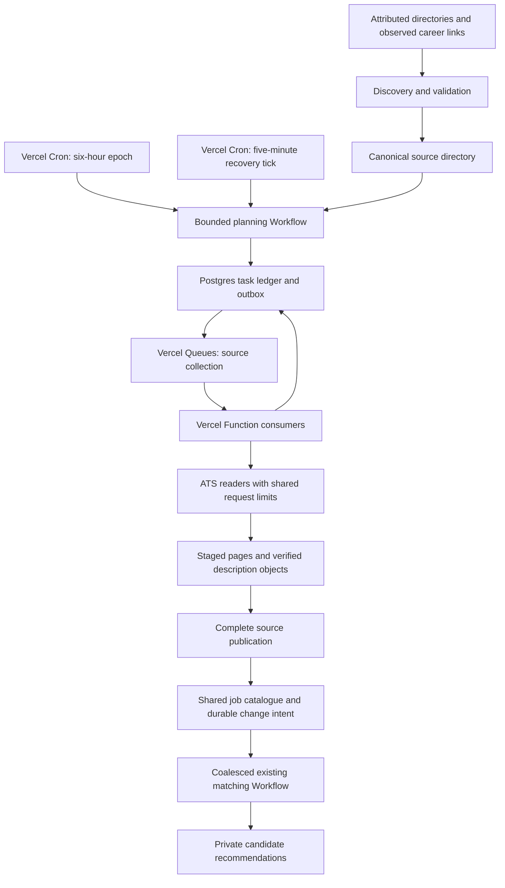

# Career-site collection at 50,000 sources

Status: proposed architecture, 2 November 2026. This document does not install a
queue, apply migrations, change budgets or modify the deployed scheduler.

The first two slices have an opt-in [SQL ledger, receipts and bounded worker](catalog-source-tasks.md).
The worker remains single-lane. Delivery transport, shared provider permits and
cohort cutover remain proposed; production is not switched.

## Decision and scope

Build a shared collection module with a durable source-task ledger, a transactional
outbox, Vercel Queues delivery, and bounded Vercel Function consumers. Keep Vercel
Workflow for bounded discovery/maintenance coordination and the existing matching
and application pipelines. Collection execution and scheduling stay on Vercel;
the existing Supabase database and public-description bucket remain the data stores.

The target is 50,000 validated sources, with a six-hour refresh policy for active
sources. This is a capacity goal, not an established throughput or coverage claim.
50,000 sources do not imply 50,000 distinct employers, jobs or fresh sources.
The same design can be evaluated at 500,000 sources after measured capacity gates.

Reuse our own ATS readers and discovery pipeline. Do not introduce a third-party
job catalogue. Preserve broad profession/country coverage, account isolation,
existing storage limits and the separate application-submission authorization path.

Vercel documents Queues as a beta delivery primitive with at-least-once delivery.
Its suitability here is fan-out, delayed work and controlled consumption. Workflow
remains useful for stateful multi-step operations. Pin the eventual SDK version
and verify its trigger and retry configuration before implementing the transport.
[Queues](https://vercel.com/docs/queues),
[SDK](https://vercel.com/docs/queues/sdk).

Alternatives considered:

| Approach | Tradeoff |
| --- | --- |
| Increase concurrency inside the existing Workflow | Smallest transport change, but requires the new receipts and global permits first; retains long parent coordination and sequential batch coupling |
| One Workflow per source | Natural for sources needing durable waits across many stages; adds workflow orchestration for every check alongside the existing database checkpoints and needs separate cost measurement |
| Queues + source-task ledger, selected | Direct fan-out with explicit provider admission and resumable database state; requires an outbox/reconciler and beta-product acceptance |

Keep Queue-specific details behind the collection interface so delivery can be
replaced without changing source identity, cursor semantics or publication rules.
Avoid launching an additional Workflow for every Queue message; existing database
page checkpoints already provide continuation for these bounded collection tasks.

## Verification defined before implementation

Acceptance must prove duplicate-safe publication, crash recovery, source fairness,
provider backoff, complete-snapshot closure and budget enforcement before adding
concurrency. Hosted acceptance then measures actual source completion, bytes,
queue operations and database latency across three successive refresh periods.
Synthetic throughput alone cannot establish live provider capacity.

This design is checked against current entry points, existing SQL invariants,
official Vercel documentation, capacity arithmetic and the failure scenarios below.
No runtime test or deployment is required for this documentation-only change.

## Existing implementation and constraints

| Existing module | Reuse | Required change |
| --- | --- | --- |
| [`/api/cron/jobs`](../app/api/cron/jobs/route.ts) | Secret-protected admission and six-hour schedule | Admit an epoch and bounded planning work; stop tying all source work to one parent lease |
| [`workflows/catalog.ts`](../workflows/catalog.ts) | Cleanup, discovery, operator progress | Replace sequential 100-source batches with bounded planning and recovery |
| [`dispatch.ts`](../lib/server/catalog/dispatch.ts) | Operator/scheduled admission seam | Coalesce source tasks and create outbox intents transactionally |
| [`sync.ts`](../lib/server/catalog/sync.ts) | Page fetching, source leases, capacity reservations and publication | Expose one bounded source advance; move aggregate admission and write limits into shared database state |
| [`feeds.ts`](../lib/server/catalog/feeds.ts), [`additional-ats.ts`](../lib/server/catalog/additional-ats.ts) | Existing ATS readers and normalization | Add adapters behind the existing reader seam as observed coverage requires |
| [`discovery/`](../lib/server/catalog/discovery/) | Provenance, validation and activation | Separate discovery capacity from job refresh capacity |
| [`match-dispatch.ts`](../lib/server/matching/dispatch.ts) | Existing durable matching admission | Coalesce publication changes and wake matching without awaiting a whole global sweep |

The present refresh processes batches sequentially, downloading up to four feeds
concurrently within each batch. Its `last_step_id`/`last_result` receipt represents
only the most recent step. Running the existing `refreshBatch` calls concurrently
would invalidate replay accounting: one step can overwrite another's receipt.
The new task ledger replaces that accounting for the new path.

The collector's `writeTail` serializes writes only within one invocation. Multiple
Function instances would each have their own queue; it is not a global database
write limit. Preserve the motivation for that serialization by adding shared,
leased write permits before increasing parallelism.

Scoped collection already uses `catalog_collection_sources`; preserve this narrow
read. Workers must not reload the whole directory, global source health or demand
for each source. Planning should use an indexed due-source query instead of
serializing all source IDs into one refresh row.

The current configured guards are 400 MiB total database and 768 MiB public
description objects. Matching has an allocation within the database allowance.
Queue tasks, outbox rows, checkpoints and indexes must fit inside the remaining
allowance. A larger directory does not authorize increasing these limits.
See [operations](catalog-operations.md), [matching](precomputed-matches.md) and
[discovery constraints](source-discovery.md).

## Flow



The six-hour cron remains the refresh policy entry point. A proposed five-minute
Vercel tick repairs lost delivery, dispatches deferred work and discovers newly
due sources; it does not fetch every board every five minutes. Both invoke the
same bounded planner under a short admission lease. This additional cron is a
proposed implementation change, not enabled by this document.

Stagger source `next_due_at` values to avoid a 50,000-message burst. For the steady
state, admit a source based on its persisted due time rather than waiting for the
next global epoch. Epochs group reporting and budgets; source freshness and
ownership are independent of an epoch's completion.

## Module interfaces and ownership

The collection module exposes three operations:

```ts
interface Collection {
  planCollection(input: {
    now: Date
    origin: "scheduled" | "recovery" | "operator"
    limit: number
  }): Promise<PlanningReceipt>
  advanceCollection(input: {
    taskId: string
    dispatchGeneration: number
  }): Promise<AdvanceReceipt>
  readCollectionStatus(input: { epochId: string }): Promise<CollectionStatus>
}
```

These are proposed interfaces, not new exports. `origin` is scheduled, recovery
or an authorized operator request. Callers do not coordinate leases, choose page
cursors, infer closures or maintain their own retry loops. The implementation
owns those details behind the seam. Queue delivery and the existing manual route
call the same `advanceCollection` operation.

Discovery owns source identity and evidence. Collection owns source observations
and catalogue changes. Matching owns candidate recommendations. Applications own
candidate facts, approval and submission. Collection messages contain no candidate
identity, resume, credentials or application packet, and never authorize a send.

An ATS adapter reads one bounded page and reports normalized postings, observed
source IDs, a continuation and explicit inventory scope/completeness. It does not
write account data, claim tasks or decide global scheduling. Reuse the current
adapter seam; add capabilities only where actual provider behavior differs.

## Durable data model

Use additive migrations; retain existing catalogue IDs and saved/application links.

| Record | Important facts and invariants |
| --- | --- |
| Source directory + schedule | Canonical identity, employer evidence, region/host/tenant/board, adapter version, inventory kind, policy interval, `next_due_at`, health and access state |
| Collection epoch | Origin, start time, budget reservation and aggregate reporting; it is not the ownership lock for every worker |
| Collection task | Source, inventory scope, adapter/config generation, current source run, cursor, state, attempt token/expiry, `not_before`, attempts, terminal result and dispatch generation |
| Outbox intent | Task ID + dispatch generation, availability time, publish lease and confirmed delivery metadata; unique logical send intent |
| Source run and staged page | Existing `job_catalog_runs` and staged items, strengthened with replay-safe page receipts |
| Provider capacity | Global and provider/host concurrency, request-token budget, `blocked_until`, expiring permits and usage counters |
| Publication receipt | Unique source run ID, actual additions/changes/closures and a durable matching-change intent, committed with publication |

Keep one active full-inventory task per canonical source/config generation. An
operator trigger joins or prioritizes active work. A customer-scoped search may
reuse compatible work, but a partial search scope must never impersonate a full
board snapshot. Configuration changes fence old work and create a new generation.

Define identity using the real regional host and tenant/board. Existing source
parsing recognizes some EU hosts while canonical IDs omit their region. Introduce
region-aware source identities and an alias migration before adding those readers;
do not collapse EU and global boards or regenerate existing job IDs wholesale.
An employer can own multiple boards; merging employers requires evidence beyond
a matching name. Preserve Workday site case and other provider-specific identity.

Suggested indexes: due scheduling by `(enabled, next_due_at, id)` (partial where
appropriate), runnable tasks by `(state, not_before, id)`, outbox dispatch by
`(state, available_at, id)`, and source-run receipts by stable run/page identity.
Enforce active-task uniqueness with a database constraint, not a preflight SELECT.
Claims use short transactions and `FOR UPDATE SKIP LOCKED`; network calls occur
outside database transactions.

## Delivery, retries and crash recovery

1. Planning atomically creates or joins a source task and writes its outbox intent.
2. A publisher claims a bounded outbox batch, sends small ID-only messages, and
   records confirmation. Queue deduplication keys use task ID + dispatch generation.
3. A consumer atomically verifies generation and claims the task. Duplicate or
   completed deliveries return without starting a new source run.
4. It obtains expiring global/provider permits, checks provider backoff, and advances
   a bounded number of pages within a configured execution/byte budget.
5. A page receipt keyed by run/cursor commits with staged items, counts and cursor.
   Lost responses replay the committed receipt; they do not increment page counts
   or skip inventory. Checkpoint and publication RPCs verify the attempt token.
6. Completion publishes one source snapshot and its receipt atomically. Pending
   work records a continuation and next outbox intent in the same transaction.
7. The queue handler acknowledges only after a durable completion, continuation,
   deferral or recorded terminal failure. Uncommitted transient failures throw.

Vercel retries thrown handlers and acknowledges successful returns. Delivery is
at least once; queue idempotency has a finite window, so database state remains
authoritative. Do not depend on message retention for long-lived progress.
[Queue SDK](https://vercel.com/docs/queues/sdk).

On 429/Retry-After, persist the provider's next allowed time and release work;
reschedule rather than sleep in a Function. Honor the longer of provider and
task backoff. Provider access refusals and invalid source identities become
explicit blocked/quarantined results, with a review/revalidation path. Neither
condition is a successful empty inventory.

The recovery tick republishes tasks whose delivery was lost or expired only after
confirming no live task/source lease. It increments dispatch generation so an old
message cannot steal current work. A task lease alone never grants a new source
lease; use the existing source token as the final publication fence. Work resumed
from an old run must match the adapter/config generation or restart safely.

Use one collection consumer group initially: additional consumer groups receive
the same stream independently and would duplicate collection effort. Delayed
messages and retry limits are delivery controls; PostgreSQL retains the durable
failure record before any poison message is acknowledged. Budget exhaustion is a
named paused state, not an endless retry or an empty successful scrape.

## Parallelism and publication

Control three capacities separately: concurrent source advances, outbound
requests per provider/host/tenant, and database publication/checkpoint writes.
Start a canary with at most eight source advances and one shared write permit;
choose provider request limits conservatively and tighten them on observed 429s.
These are proposed starting limits, not provider entitlements or measured optima.
Keep a reserved share of collection capacity for rotating oldest sources so
candidate demand cannot permanently starve other countries or professions.

Every request, including pagination and detail reads, needs a provider permit.
An in-memory semaphore cannot coordinate multiple Functions. Permits expire and
are fenced; a process crash cannot consume capacity indefinitely. Reuse atomic
storage reservations, counting all concurrent staged writes and publication
headroom. Never reserve capacity for an entire global sweep before doing work.

Snapshot publication may infer missing-job closures only for a validated,
complete inventory of the same declared scope. Search windows, provider caps,
partial pages and failed parsing retain the preceding published snapshot.
Partitioned inventories publish only after every partition is complete; until
partition support exists, capped sources stay explicitly incomplete.

Preserve source posting time, first discovery, last observation and content-change
time separately. Re-observation does not reset job age. Prefer stable ATS IDs;
retain existing IDs through compatibility mappings. Content hashes avoid unchanged
description writes and repeated matching. Cross-source duplicate grouping retains
each original URL and provenance instead of deleting evidence based on title alone.

Write a small catalogue-change intent with successful publication. A bounded
coalescer wakes the existing matching dispatcher for meaningful changes and
freshness-policy refreshes; do not start a global matching sweep for every page
or wait for all 50,000 sources. First implementation may coalesce the existing
global sweep once per window; affected-country/account routing is a later measured
optimization. Existing private generations and matching capacity stay authoritative.

## Discovery and coverage growth

Keep discovery as a separately budgeted lane:

1. Import attributed, pinned public ATS directories as candidates.
2. Extract additional identities from observed employer career links, existing
   application links and bounded URL-index/sitemap discovery.
3. Validate canonical employer/board identity, live access and adapter support.
4. Activate only under existing validation policy and available collection capacity.
5. Refresh and publish real listings; report active/fresh supply separately from
   candidate-directory size. Periodically revalidate moved or inactive boards.

Follow [the existing discovery strategy](employer-discovery-strategy.md). Extend
SmartRecruiters/Workday evidence and coverage before claiming more families. Add
Recruitee, Teamtailor or other readers only after finding meaningful, attributable
source candidates and passing inventory/pagination fixtures. Existing application
form support is not evidence of source discovery coverage.

Prefer documented feeds, tested public career-site JSON and JobPosting structured
data. Arbitrary career URLs require the existing public-network/DNS/redirect/body
guards before fetching. Custom HTML/browser collection is a separately admitted
cost and maintenance lane; it is not required for initial 50,000-source evaluation.
Register source identities from observed URLs and validated provider responses.

## Capacity, cost and freshness

At one check per source per six hours:

| Active sources | Checks/day | Average checks/second | Concurrent source slots at 10 seconds/check and 70% utilization |
| --- | ---: | ---: | ---: |
| 7,229 | 28,916 | 0.335 | 5 |
| 50,000 | 200,000 | 2.315 | 34 |
| 500,000 | 2,000,000 | 23.148 | 331 |

This is illustrative arithmetic, not a benchmark. Slots use
`ceil(sources * mean_check_seconds / (21600 * utilization))`. Actual source time,
page counts, detail requests, bandwidth, database writes and provider throttling
must be measured. Four downloads do not imply four simultaneous database commits.

Meter actual queue operations, Function CPU/memory duration, HTTP requests/bytes,
storage writes and matching rebuilds. Queue pricing counts operations rather than
jobs; payload size, idempotency options, retries and continuation add work, and
consumer compute is billed separately. Keep messages small and apply daily task,
request, byte and operation caps before increasing admitted work. Do not call
this workload free or quote a monthly total without regional measurements.
[Queue pricing and limits](https://vercel.com/docs/queues/pricing).

Storage is an independent admission gate. For illustration, one million retained
records at 1 KiB of metadata each exceed 976 MiB before indexes, checkpoints,
matching and descriptions. Even a source directory plus one day of 200,000 task
receipts can consume meaningful space. Measure physical table/index/TOAST bytes,
description packs and task history, not just JSON payload sizes. Prune terminal
task/outbox history in bounded batches, keep aggregate operational totals, and
preserve records required to fence outstanding messages and resumable work.

At the existing limits, grow only while sufficient measured headroom remains.
If retaining the required real supply cannot fit, stop expansion and present the
measured gap. A larger catalogue would then require an explicit storage decision;
do not silently reduce coverage, delete protected history or increase the budget.

Proposed operating targets: check active sources on a six-hour policy, aim for
95% of enabled non-quarantined sources to have a successful complete observation
within 6h30m, and keep dispatch delay below ten minutes at p95. Report quarantined,
blocked and failed counts alongside this denominator, plus freshness for *all*
enabled sources. These are targets to test, not service guarantees. Use staggered
due times and the recovery tick; a six-hour cron alone does not bound completion
age. Show actual queue age, oldest source age, per-provider success, complete vs
partial snapshots, additions/updates/closures, rejected postings and capacity pauses.
Posting-to-discovery lag is measured only where the source supplies a usable
posting timestamp; retain unknowns instead of estimating them.

## Failure walkthrough and acceptance

| Scenario | Required observable outcome |
| --- | --- |
| Two cron invocations or repeated queue deliveries | One active task/source attempt; no duplicate publication or additive counters |
| Crash after task commit but before queue publish | Outbox recovery delivers the pending task |
| Lost publish response or message expires | Idempotent delivery/reconciliation; task remains recoverable beyond queue retention |
| Crash after page commit | Resume at committed cursor; replay receipt prevents duplicate page accounting |
| Crash after source publication but before queue acknowledgment | Return existing publication receipt; no second closure/change event |
| Worker token expires while HTTP is in flight | Replacement may advance; old attempt cannot checkpoint or publish |
| 429 with a long retry time | Persisted provider deferral; unrelated providers progress; no immediate retry loop |
| One slow or malformed board | Bounded failure/incomplete result; other tasks continue |
| Partial search or provider result cap | No source-wide missing-job closure |
| Database/object/queue budget exhausted | Named pause, retained preceding catalogue and protected applicant history |
| Lost matching wakeup | Durable change intent replays through coalescer without rebuilding on unchanged checks |
| Regional identity or adapter config changes | Old generation fenced; aliases preserve saved job references |
| Deployment replaces a consumer | Stable task payload version, backward-compatible reader or explicit quarantine; unfinished work remains recoverable |

Use existing Postgres/PGlite integration patterns for constraints, RLS, concurrent
claims, token fencing, unique receipts and counter idempotency. Exercise the
collection interface with recorded ATS fixtures for pagination, empty/closed,
malformed, caps, language/location variants, backoff and response loss. Hosted
canaries must prove cross-instance write/request limits and real source results.

## Implementation slices and rollout

1. **Replay-safe source tasks.** Add source scheduling, task/outbox records and
   atomic receipts. Keep a single execution lane. Demonstrate every crash point
   above against fixtures before changing transport or concurrency.
2. **Bounded collection interface.** Implemented as `advanceCollection`, with
   existing source-run tokens and complete-snapshot publication, bounded pages,
   requests, time and staged inventory, durable retries and replay-safe release.
   Global task execution stays single-lane. Shared provider/write permits remain
   required before increasing concurrency; the legacy entry point rejects active
   or quarantined task-owned runs.
3. **Vercel delivery canary.** Add an authenticated Queue consumer and bounded
   outbox publisher/recovery tick. Admit a known 100-source cohort with low limits;
   verify the beta product, project permissions, OIDC, region and actual metering.
4. **1,000 then 10,000 sources.** Use real providers, representative board sizes,
   three refresh periods, injected consumer death and lost-delivery recovery.
   Increase concurrency only when database/provider/cost evidence supports it.
5. **Broader discovery and 50,000 evaluation.** Validate new sources incrementally.
   Gate each increase on freshness, successful collection, storage and spend. A
   500,000-source evaluation is a separate measured step after the 50,000 gate.

Canary ownership is explicit per source: use `legacy` or `tasks-v1` assignment,
and exclude task-owned sources from old global/operator collection selection.
Both paths retain existing source token fences during migration. Drain active
tasks and pending outbox intents before returning sources to the legacy path;
rollback does not delete catalogue records or unapplied durable work. Do not
reuse the singleton refresh lease or single last-step receipt as a parallel-worker
counter. No billing, storage or production-scheduling changes are made by this plan.
