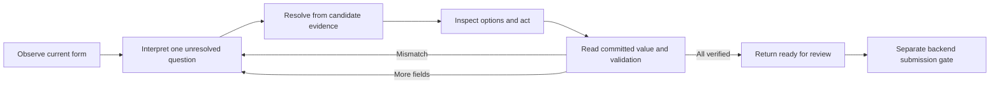

# Browserbase options for reliable application filling

Reviewed 4 November 2026. Research and proposed experiments; no new employer runs or runtime changes were made for this investigation.

## Recommendation

Keep Browserbase as the browser provider. Benchmark a bounded, field-by-field agent built with Stagehand v4 against the existing planner, and use managed Browserbase Agents as a challenger on synthetic forms. Change the interaction and answer-resolution loop before changing hosting.

This recommendation is an engineering inference from the code and documented capabilities, not a measured claim that a replacement is more reliable. Neither previous Prenuvo cloud attempt reached the pre-submit checkpoint. There is no evidence yet for universal form support.

The important distinction is between understanding a question, selecting an answer from candidate evidence, operating the widget, and proving that the widget accepted it. An API that clicks successfully does not establish the other three.

For the wider platform and REST endpoint inventory, see [Browserbase API inventory](browserbase-api-inventory.md).

## What we actually use today

The installed versions are Stagehand **4.3.0** and Browserbase Node SDK **2.23.0**, verified in `node_modules` as well as `package.json`.

| Code | Current responsibility | Consequence |
| --- | --- | --- |
| `lib/server/applications/browser-session.ts` | Launches Browserbase through Stagehand, then attaches Playwright over CDP to the same session. Explicitly disables self-healing, caching, browser recordings and browser logs. | These settings trade adaptation/debugging visibility for predictable actions and less persisted candidate data; changing them globally is not a reliability fix. |
| `lib/server/applications/stagehand-form.ts` | Calls `stagehand.extract()` to map the entire current set of observed controls to questions, with `screenshot: false`. | The default planner has no visual evidence to resolve an ambiguous compound input. |
| `lib/server/applications/stagehand-actions.ts` | Uses Stagehand `act(Action)` for an exact prevalidated click/fill. File uploads, option clicks, native selects and checkbox operations remain on Playwright. | We do not currently give Stagehand natural-language control of a failed widget. We use its deterministic executor after choosing the action ourselves. |
| `lib/server/applications/computer-agent.ts` | Owns binding, answer reuse, filling, re-observation, bounded retries and final approval/receipt checks. Includes an alternative screenshot-driven `computer` planner. | Switching planners still shares important binding, answer and widget logic; it is not an independent replacement. |
| `lib/server/applications/computer-browser.ts` | Owns DOM extraction, frame/control identity, selected-value observation and exact option lookup. | Custom observation limitations propagate into both planners. |

The Prenuvo tests separated two problems: the LinkedIn answer was lost across URL/text interpretation, and a country picker had previously been labeled Phone and given a telephone number. The new label logic prevents that particular collision, but the stored packet still contains the old answer. A benchmark must include that corrupt packet as an expected safe stop; a successful browser action must not hide wrong input data.

The protected diagnostic intentionally supplied the stored packet without the worker's `savedAnswers` callback. The normal worker also runs question-memory/profile/answer resolution (`lib/server/applications/worker.ts`). Therefore the diagnostic is evidence about packet replay and the browser executor, not a complete end-to-end evaluation of the normal production worker.

## Current Stagehand capabilities worth testing

Stagehand v4 removed `agent()` rather than replacing it with another built-in orchestrator. The supported approaches are generated scripts or an external model/tool loop. We should not build from v3 `stagehand.agent()` examples. [v4 migration guide](https://docs.stagehand.dev/v4/migrations/v3)

| Capability | Documented behavior | Proposed use here |
| --- | --- | --- |
| `page.snapshot({ includeIframes: true })` | Accessibility-oriented tree with XPath and URL maps. | Compare its view of the form with our custom observer; use current references rather than persistent positional selectors. [Page reference](https://docs.stagehand.dev/v4/reference/page) |
| Scoped `extract()` | Accepts a locator and ignored subtrees; optional screenshot adds current-viewport visual evidence. | Examine the failing field and its surrounding question, rather than repeatedly interpreting the entire career page. Scroll that field into view before visual extraction. Schema-valid JSON still needs grounding checks. [Extract](https://docs.stagehand.dev/v4/basics/extract) |
| `observe()` followed by `act(Action)` | Proposes structured executable actions; replaying an Action avoids another inference call. | Let the model propose a way to open/search/select one widget, validate the target and approved value, execute, and verify. [Observe](https://docs.stagehand.dev/v4/basics/observe) |
| Natural-language `act()` | Infers a single action; iframe/shadow traversal is built in. `selfHeal` can re-infer a broken selector and retry once. | Benchmark scoped recovery, not global self-healing of submission or consent actions. A returned success is an action result, not proof of the correct candidate answer. [Act](https://docs.stagehand.dev/v4/basics/act) |
| Native locators and file inputs | Cross-frame/shadow selectors and `setInputFiles` are available. | Test whether native widget operations can replace some of our marker/CDP adapter. Preserve Playwright until equivalent validation and request guarding are demonstrated. [Locator reference](https://docs.stagehand.dev/v4/reference/locator) |
| `experimentalBatch()` | Runs trusted callbacks in the extension worker, reducing command round trips. Experimental; an in-flight operation may finish after timeout, so it is not atomic. | Benchmark small deterministic groups of independent fields, with checks inside the callback. Do not batch the final submit. Installed 4.3.0 exposes this API. [Stagehand reference](https://docs.stagehand.dev/v4/reference/stagehand) |
| Server-side cache | Caches eligible interpretation/action results; cache keys omit model configuration. Visual extraction bypasses cache. | Optimize only after accuracy is established; keep cache off for model comparisons and final verification. [Caching](https://docs.stagehand.dev/v4/best-practices/caching) |
| WebMCP `page.tools()` | Calls tools that the website itself registers. | An optional capability probe. It cannot make Prenuvo or arbitrary ATS sites expose structured form APIs; support on Prenuvo has not been verified. [WebMCP](https://docs.stagehand.dev/v4/basics/webmcp) |

Stagehand's external framework integrations provide persistent snapshot/action/screenshot tools, but the repository integrations are marked experimental. Its AI SDK adapter uses a long-lived MCP/stdio process and is not a standalone published adapter. We can adopt the control-loop pattern without introducing an MCP child into the existing Vercel worker. [Framework integrations](https://docs.stagehand.dev/v4/integrations/agent-frameworks/overview), [AI SDK integration](https://docs.stagehand.dev/v4/integrations/agent-frameworks/vercel-ai-sdk)

## Alternative execution approaches

### 1. Our agent with Stagehand browser tools — first choice to prototype

Keep the current durable application record, answer evidence, document hashing and backend submission gate. Replace the rigid fill-all/review-all recovery path with a small loop over unresolved fields:

The meaningful change is allowing the agent to inspect options and recover a specific field while retaining completed work. It should choose from current observed targets/options and approved answer references. A toolkit such as `inspectField`, `listOptions`, `fillApprovedAnswer`, `selectObservedOption`, `verifyField`, and `requestMissingAnswer` is a proposed application interface, not a Browserbase API.

Keep question meaning separate from widget type: a LinkedIn URL is a semantic fact even when rendered in `input[type=text]`. Likewise, phone dialing country, residence country and citizenship are different facts. Store the evidence and mapping separately from the DOM label. An option label may differ from a canonical candidate value, but any mapping must preserve meaning and resolve ambiguity rather than choose the first plausible match.

Use deterministic operations for clear controls, scoped model interpretation when needed, and visual inspection for unresolved custom widgets. A broader tool loop is useful only if it can do this; wrapping the same `fillAll` method in another model will retain the same failure modes.

### 2. Managed Browserbase Agents — benchmark challenger

`POST /v1/agents/runs` starts a managed browser agent with a task, optional reusable agent, variables and result schema. Browserbase owns its model/tool/runtime loop. It offers built-in browser, search, filesystem and shell capabilities, but currently does not let callers add custom tools or disable the built-ins. That makes it a useful comparison for generalization, with less control than our current worker. [How Agents work](https://docs.browserbase.com/platform/agents/how-it-works)

`pauseWhen` provides a natural-language condition under which the model may request input. The browser remains alive while paused, but the file workspace is discarded on resume and variables must be handled carefully. This is not documented as a deterministic interception of every submit action. Run it on a controlled synthetic receiver before entrusting it with a real stop-before-submit task. [Pause/resume](https://docs.browserbase.com/platform/agents/pausing-runs)

There is no documented input-file upload-to-Agent API yet. Agents can use files they create or download; this does not prove that a downloaded approved PDF can be attached through every employer widget. A signed-file-download route may be feasible, but document-byte integrity, attachment and pause/resume behavior need an explicit test. [Agent file limits](https://docs.browserbase.com/platform/agents/managing-files)

The installed SDK 2.23.0 exposes run creation, retrieval, listing and messages, plus `pauseWhen`, but its `Runs` class does not expose resume/stop methods. Those would need verified direct REST calls or an SDK update.

### 3. Browser Use or a model-native browser toolset — independent comparison

Browser Use is a separate Python agent framework that can connect to a Browserbase session over CDP; it is not another name for the managed Agents API. It provides an independently implemented control loop, making it a useful challenger if the Stagehand prototype remains brittle. Introducing a Python worker and adapting document/submission controls are real costs for this TypeScript application. [Browser Use integration](https://docs.browserbase.com/integrations/browseruse/python)

Stagehand also documents a Claude browser toolset in which the model SDK owns the agent loop. This is another way to test model-driven interaction while retaining Browserbase infrastructure. Neither integration provides evidence of reliable Prenuvo completion by itself. [Claude toolset](https://docs.stagehand.dev/v4/integrations/agent-frameworks/claude-cua-toolset-quickstart)

### 4. Browserbase Functions — hosting optimization after correctness

Functions can move the browser-driving TypeScript code into Browserbase's execution environment. Current documented limits are us-west-2, 60–900 second invocations, 64 KB parameters, a 25 MB build limit and no `keepAlive`; the browser closes when the invocation ends. This fits bounded fill/check jobs better than an indefinitely open approval session. Keep durable state and approval in the application. [Functions limits](https://docs.browserbase.com/platform/functions/limits)

This may reduce network round trips; it will not correct mislabeled questions or bad saved answers. Measure browser operation time separately from model inference before migrating hosting.

## Platform features that support the workflow

The companion inventory covers Sessions, Contexts, uploads/downloads, replay/logging, proxies/Verified/CAPTCHA, navigation policies, extensions, Functions/Secrets/Webhooks, Search/Fetch, Model Gateway and developer tools. Most address access, persistence, observability or execution rather than semantic form understanding.

For the next diagnostic runs, use opt-in recording or Browserbase's `browser-trace` tooling on synthetic data. It can capture CDP events, screenshots and DOM snapshots alongside the automation. This would make a stalled dropdown or changed form inspectable instead of reducing the failure to one exception string. Do not enable indefinite recording of all candidate sessions as a side effect of research. [Browser trace](https://docs.browserbase.com/integrations/skills/browser-trace)

Live View is already a relevant fallback for genuine unknown answers or unsupported controls. It supports watching and interacting with the same running session. Human assistance should resume from verified completed fields instead of restarting the entire form. [Live View](https://docs.browserbase.com/platform/browser/observability/session-live-view)

## Proposed experiment and acceptance criteria

This is a proposed benchmark, not work already executed:

1. Create ten controlled forms covering native inputs, React-style single/multi-select, delayed location search, compound country/phone fields, iframes, shadow roots, repeated labels, conditional questions, upload/autofill, and multiple steps.
2. Include a deliberately corrupted saved answer and a truly missing candidate fact. Expected result: an explicit unresolved field, not fabricated completion.
3. Compare the current planner, the bounded Stagehand field agent, and managed Agents on identical synthetic candidate facts. Give each a fixed time/decision budget; disable caches for model comparisons. Run each fixture three times initially (30 runs per candidate), then expand the sample if it warrants promotion.
4. Use an independent form-state checker, rather than the model's success flag or the same extraction code that selected the answer. Check semantic correctness, committed option values, validation state, uploaded document identity and conditional-field coverage.
5. Count complete pre-submit success, incorrect values, safe stops, unexpected submission attempts, repeatability, elapsed time, model calls and cost per correct completion. A partial fill is a failure of end-to-end completion; a justified stop is separately classified, not forced into a success metric.
6. Run the best candidate against Prenuvo with corrected, confirmed source facts and submission disabled. Repeat fresh sessions, checking the saved application record remains unchanged. Treat this as employer-specific evidence, not proof of arbitrary-form reliability.

Promote only after it beats the baseline without any unexpected submission or invented answer. Keep the existing `beforeSubmit`/`confirmOnce` boundary, durable intent recording, final value recheck and ambiguous-outcome handling. The official Stagehand form-approval cookbook likewise places approval and the single submit attempt in application code, and notes that durable service approval needs more than a CLI prompt. [Form approval cookbook](https://docs.stagehand.dev/v4/cookbooks/approve-form-submission)

## Scope and verification of this research

Read the current Browserbase/Stagehand documentation indexes and relevant primary reference pages; compared them with installed SDK declarations and the current repository execution path. All performance and reliability improvements above are hypotheses for the benchmark. No production configuration, secrets, stored candidate answers, or employer form state were changed during this research.
