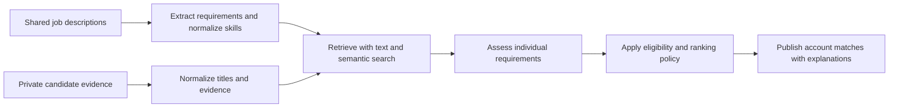

# Matching engine: implementation adoption review

Reviewed 2026-10-31. First-party documentation, public source code and model cards were inspected. No external code was executed, model downloaded, dependency installed, customer data transmitted or paid account created. This is an adoption recommendation; performance and quality remain unmeasured.

## Decision

For an engine we own, adopt extraction, title normalization and retrieval components inside the existing matching workflow. Keep requirement assessment, eligibility, evidence validation and ranking policy under our control. Do not fork a resume builder and treat its overall ATS score as professional suitability.

For an outsourced engine, Textkernel is the strongest documented integration candidate from this review, with RChilli as an alternative. This is a documentation-based shortlist, not a measured quality comparison. Both require a paid-provider evaluation and integration rather than source-code adoption.

No reviewed open-source application was verified as a drop-in replacement for our complete authenticated catalogue-matching pipeline. There are useful, inspectable components and an experimental pretrained pair scorer.

## Shortlist: what we can actually reuse

| Implementation | Reusable part | Runtime and license evidence | Decision for this app |
| --- | --- | --- | --- |
| [Nesta Skills Extractor](https://github.com/nestauk/ojd_daps_skills) | Extract skill phrases, preserve spaCy spans and map them to ESCO concepts. Actual [`SkillsExtractor` source](https://github.com/nestauk/ojd_daps_skills/blob/dev/ojd_daps_skills/extract_skills/extract_skills.py) exists. | Python, spaCy, transformer/model assets. Package code [MIT](https://github.com/nestauk/ojd_daps_skills/blob/dev/LICENSE); model/taxonomy licenses are separate. | Preferred extraction experiment. Explicitly select `esco`; default is `toy`. Check compatibility of pinned dependencies and verify evidence against the original text because preprocessing cleans it. It does not supply required/preferred/negation or candidate proficiency logic. |
| [TechWolf JobBERT-v3](https://huggingface.co/TechWolf/JobBERT-v3) | Semantic similarity between differently worded job titles. Published weights and inference instructions. | Sentence Transformers/Python; model card declares MIT. 1,024-dimensional output, maximum 64-token input. | Evaluate as a replacement for our narrow title aliases/relevance gate. It is a short-text title model, not a full resume/JD assessor. Never feed an entire resume into its short context and assume full coverage. |
| [Supabase hybrid search](https://supabase.com/docs/guides/ai/hybrid-search) | Concrete SQL combining Postgres full-text search, pgvector retrieval and reciprocal rank fusion (RRF). | Fits our Postgres/Supabase stack. [pgvector license](https://github.com/pgvector/pgvector/blob/master/LICENSE) permits reuse with its notices; follow source licensing/attribution when copying implementation text. | Preferred catalogue retrieval pattern. Adapt filters, language handling, result budgets and RLS. The sample's result limits are tutorial choices, not our completeness contract. An RRF value is a retrieval rank signal, not a fit percentage. |
| [Sentence Transformers retrieve/re-rank](https://www.sbert.net/examples/sentence_transformer/applications/retrieve_rerank/README.html) | Runnable bi-encoder retrieval followed by cross-encoder comparison on shortlisted pairs. | Python/PyTorch; [library Apache-2.0](https://github.com/huggingface/sentence-transformers). Each model has separate terms and task/language limits. | Reuse the implementation pattern for semantic ranking/evidence retrieval. A generic relevance model does not establish a required credential or hiring eligibility. Run inference in a worker/service, not during listing reads. |
| [job-eval](https://github.com/KasraAhmadi/job-eval) | Actual [`Scorer`](https://github.com/KasraAhmadi/job-eval/blob/main/jobeval/scorer.py) and published pretrained pair-scoring weights. Four outputs cover requirements, seniority, domain and keywords. | Python/PyTorch; repository MIT; [model card](https://huggingface.co/kasraahmadi/job-eval-modernbert) declares Apache-2.0 weights. | Closest inspected open pretrained qualification scorer, but experimental. English training, LLM-produced labels, weak seniority supervision and input truncation are material limits. Attention-selected paragraphs are not validated requirement evidence. Benchmark before selecting it. |
| [Resume-Matcher](https://github.com/srbhr/Resume-Matcher) | Inspectable deterministic demand coverage and subscore reporting in [`ats.py`](https://github.com/srbhr/Resume-Matcher/blob/main/apps/backend/app/services/ats.py). | Python backend, Next.js UI; [Apache-2.0](https://github.com/srbhr/Resume-Matcher/blob/main/LICENSE). | Useful source/test reference, not a wholesale replacement. The reviewed total includes 15% section completeness and 10% date consistency. Required/preferred skills are combined in coverage. Those choices describe resume presentation/coverage rather than qualification fit. |
| [AI Career OS](https://github.com/semirturgay/ai-career-os) | Structured extraction, optional resume evidence retrieval, typed strengths/gaps and review flows. Actual [analyzer](https://github.com/semirturgay/ai-career-os/blob/main/app/services/match/analyzer.py) is inspectable. | FastAPI/Python, React, Postgres/pgvector; MIT-labelled repository. | Architecture reference. Its final numeric score comes from an LLM structured-output call, so copying it would not give us a deterministic scoring policy or proof that evidence strings are grounded. |

### Normalization data

Use ESCO as a taxonomy candidate for stable occupation/skill identifiers, alternate labels and relationships. The Commission provides downloadable data and an API and describes job matching as an intended use. Its downloadable dataset is not itself a ranking engine. [ESCO use cases](https://esco.ec.europa.eu/en/use-esco), [download formats](https://esco.ec.europa.eu/en/use-esco/download)

Keep software and data terms distinct: ESCO's API software is documented as EUPL 1.2; the Commission's general content reuse notice is CC BY 4.0 unless otherwise indicated. Verify the chosen dataset/package notices and preserve version/attribution before redistribution. Do not label all ESCO assets MIT. The current local API is marked for replacement, favoring dataset import or the hosted API over adopting that server blindly. [API notice](https://esco.ec.europa.eu/en/use-esco/use-esco-services-api), [Commission reuse notice](https://commission.europa.eu/legal-notice_en)

For US occupation descriptors, O*NET database data is another candidate under its versioned CC BY 4.0 terms. Treat occupation-level typical skills as retrieval enrichment, not proof that a specific employer requires them or a candidate possesses them. [O*NET database license](https://www.onetcenter.org/license_db.html)

### Other leads and why they are lower priority

- [SkillNER](https://github.com/AnasAito/SkillNER) has MIT extraction code with normalized skill IDs and matched spans. Its default [data loader](https://github.com/AnasAito/SkillNER/blob/master/skillNer/general_params.py) fetches remote databases and writes local JSON; the README says the database derives from EMSI. Artifact availability and data rights must be verified separately. It is a Python/spaCy extraction component, not a complete matcher. Nesta's explicit ESCO path makes it a better first experiment for us.
- [JobMatchAI's linked repository](https://github.com/coral-lab-asu/job-hunt-AI) provides demo/install assets and prebuilt images; the reviewed public tree did not expose the matching backend implementation. Its demo lacks authentication/rate limiting. The associated paper is architecture reading, not sufficient source to vendor an engine.
- [OpenResume](https://github.com/xitanggg/open-resume) is an AGPL-3.0-labelled builder/parser, not a matching engine. It duplicates a layer we already have.
- [prism-nexus/job-match-scorer](https://github.com/prism-nexus/job-match-scorer) documents a small MIT Node lexical scorer. Source-file fetches failed during review, so only its README was verified. Do not treat it as audited or validated adopted code.

Pin repository commits and model revisions before any implementation. Moving branch URLs and historical search summaries can disagree; that occurred with an older cached Resume-Matcher scoring file in this review.

## Managed alternatives: adopt the engine as an API

### Textkernel Search & Match

The documented flow is parse/index candidates and jobs, then match a candidate against the job index. Its V2 engine supports weighted criteria and must-have/must-not-have filters, with semantic signals and returned match details. [Candidate-to-job use case](https://developers.textkernel.nl/tx-platform/v10/search-match-v2/use-cases/), [scoring overview](https://developer.textkernel.com/tx-platform/v10/search-match-v2/overview/)

The reviewed product page advertises professional plans starting at $99/month and trial credits. This is a starting price, not a quote for our catalogue. [Product/pricing page](https://www.textkernel.com/products-solutions/source-and-match/)

The V2 transaction table lists 2 credits to parse/index a job without returning normalization data and 0.05 credits per match query; 2.3 credits returns normalization data. For illustration, importing 10,000 jobs at 2 credits each means 20,000 credits before candidate processing, updates or matching. No dollar conversion is inferred. V2 is currently labeled Beta. [Transaction costs](https://developers.textkernel.com/tx-platform/v10/transaction-cost/)

Integration effort remains: synchronize updates/deletions, map our profile to its accepted parsed format, enforce account scoping, preserve explicit immigration facts, validate explanations, and account for publication/versioning and provider failures. Confirm account terms, retention and permitted downstream use before sending resumes. No vendor was contacted or trial started.

### RChilli Search & Match v4

RChilli exposes resume-to-JD indexed matching and a one-to-one endpoint with explanatory output. V4 explicitly considers experience in the relevant job profile rather than just total years, and requires documents parsed/indexed using V4. [Match endpoint](https://docs.rchilli.com/kc/internal/c_RChilli_search_match_API_Endpoints_match), [v4 behavior](https://docs.rchilli.com/kc/Search_Match_v4), [pair-scoring endpoint](https://docs.rchilli.com/kc/c_RChilli_search_match_API_Endpoints_one-to-one_Match)

This is a useful alternative paid-engine evaluation, particularly for relevant experience. Price, latency, data terms and measured relevance for our catalogue were not established here. Do not confuse repeated one-to-one calls over the full catalogue with scalable indexed retrieval.

## How adoption fits the existing implementation

The repo already owns the operational backbone:

- `lib/resume/profile.ts` and `lib/server/resume/profile.ts`: structured candidate facts with source-quote validation.
- `lib/server/account-store.ts:218`: title-only relevance gate before loading descriptions. Replace or broaden this retrieval boundary; a smarter final scorer cannot recover jobs discarded here.
- `lib/matching/index.ts`: current fixed-point scorer and reviewable/eligible flags; this is the main domain logic to replace.
- `workflows/matching.ts:49`: durable computation, stale-worker checks, staged batches and atomic publication.
- `lib/server/matching/store.ts` and `supabase/migrations/202610310011_precomputed_matches.sql`: account-scoped stored results and pagination.
- `lib/applications/auto-apply.ts`: score threshold affects unattended sends and must be assessed separately when changing score semantics.

Adopting another full application would duplicate authentication, storage, collection and workflow machinery. Our proposed engine is:

This architecture is our recommendation, not a disclosure of competitors' internals.

Required custom work: extraction of explicit required/preferred clauses and negation; matching those requirements to verified resume passages; separate supported/partial/not-demonstrated/unknown states; relevant-duration calculations without double-counting employment; explicit sponsorship/location/credential restrictions; and an inspectable scoring policy. Semantic similarity helps find evidence but cannot alone prove a requirement is met. A model score must not be multiplied by 100 and presented as hiring probability.

## Suggested adoption sequence and acceptance evidence

1. **Create the evaluation set first.** Review a small set across professions, seniority levels, countries and incomplete-data cases. Include synonym titles, mandatory licenses, negated skills, sparse descriptions and unrelated extra candidate skills. Keep a held-out subset for comparison.
2. **Extract/cache requirements independently of accounts.** Compare our existing structured-output approach with Nesta/ESCO on the same descriptions. Preserve original quotes, negation and required/preferred status; reject unsupported extraction. Cache by description checksum, taxonomy version and extraction policy/model revision.
3. **Replace the title-only gate with measured retrieval.** Compare lexical/normalized-role retrieval with hybrid search. Preserve saved jobs explicitly. Measure missed relevant roles before selecting result limits; do not silently treat a top-N shortlist as the complete catalogue assessment.
4. **Compare assessment implementations.** Test transparent requirement coverage against semantic reranking and optional job-eval pair scores. Measure retrieval recall, top-result relevance, source-evidence validity, unknown handling and stability under harmless profile edits. Validate languages separately; job-eval is English-only and JobBERT-v3 has a short title context.
5. **Publish through the current workflow.** Add scoring/model-policy versions and invalidation; preserve fencing, account isolation and complete-generation publication. Keep old production ranking until the candidate method meets agreed evaluation criteria. Validate auto-apply separately before connecting it to changed scores.

Operating cost must be measured before catalogue-wide embedding: model inference has CPU/GPU/hosting costs even with permissive code, and vector indexes consume database space. The repo's `docs/catalog-operations.md` already describes a 450 MiB maintenance ceiling. For scale intuition, 100,000 float32 vectors at 1,024 dimensions contain about 391 MiB of raw float payload alone, before row/index overhead. This arithmetic is illustrative, not a measurement of our catalogue or provider allocation. Model/dimension/quantization choices require quality and capacity tests; do not add a full-catalogue vector index by assumption.

## Recommendation to act on

Start with the owned-engine path: existing quote-grounded profile extraction and durable publishing, Nesta/ESCO extraction evaluation, JobBERT title normalization evaluation, and Supabase hybrid retrieval. Evaluate job-eval as an optional scorer, not the source of truth for eligibility. Use Resume-Matcher's explicit coverage implementation as a code reference, while defining our own evidence-based requirement policy.

If minimizing matching-model ownership is the priority and an ongoing vendor budget is acceptable, benchmark Textkernel on the same fixtures instead. Neither route is yet runtime-verified or integrated. This review changed documentation only.
